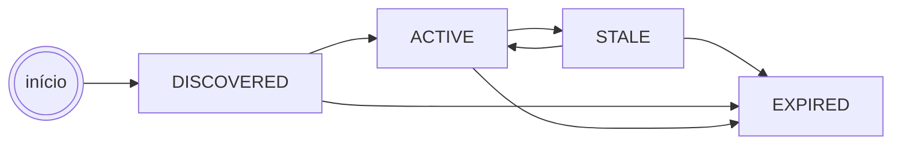
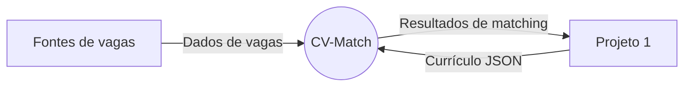
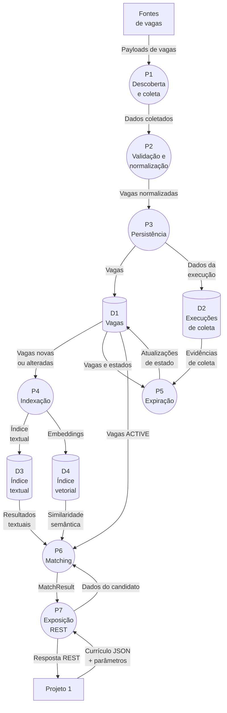

# ENGENHARIA DE REQUISITOS — MODELO DE DOMÍNIO E ARTEFATOS DE MODELAGEM
### Entidade Vaga e Processos de Dados - Equipe Data

**Projeto: CV-Match - Engenharia de Software III**
**Equipe responsável:** Data (Victória, Gustavo, Kauan, Henrique)

## Escopo do modelo

O sistema possui uma única entidade de negócio persistida: **Vaga** (`Job`).

Os seguintes objetos existem apenas durante o processamento de uma requisição e não são entidades persistidas:

* `CandidateProfile`: perfil normalizado a partir do currículo recebido;
* `MatchResult`: resultado do matching de uma vaga com o perfil;
* embedding do candidato: vetor gerado em memória durante a requisição;
* resposta da API: representação serializada dos resultados.

Não fazem parte do MVP entidades persistidas de candidato, match, operador, recrutador ou histórico de buscas. A empresa permanece como atributo textual da vaga.

Deduplicação de vagas, cadastro manual e candidatura automática também estão fora do escopo do MVP. **Classificação ou filtragem de elegibilidade geográfica também estão fora do escopo do MVP**: localização e modalidade permanecem atributos normais da vaga, armazenados, normalizados e indexados, mas o sistema não determina se uma vaga é geograficamente elegível para um candidato.

O sistema, entretanto, utiliza estruturas auxiliares de persistência e infraestrutura, como registros de fontes, execuções de coleta, taxonomia de skills, requisitos e índices vetoriais. Essas estruturas não representam entidades de negócio independentes no modelo de domínio.

## Modelo de domínio

### Entidade persistida: Vaga

| Atributo             | Descrição                                                  |
| --------------------- | ----------------------------------------------------------- |
| `id`                  | Identificador interno da vaga                                |
| `source`              | Fonte que publicou a vaga                                    |
| `source_job_id`       | Identificador da vaga na fonte                               |
| `company`             | Nome textual da empresa                                      |
| `title`               | Título do cargo                                              |
| `description`         | Descrição normalizada                                        |
| `keywords`            | Lista de palavras chave da vaga                              |
| `location`            | País, estado, cidade e declaração de localização             |
| `work_arrangement`    | Remoto, presencial ou híbrido                                |
| `salary`              | Faixa salarial, quando divulgada                             |
| `currency`            | Moeda da remuneração                                         |
| `publication_date`      | Data de publicação na fonte                                  |
| `source status`       | Estado da vaga reportado pela fonte entre ativo, inativo e indisponível | 
| `job_url`       | URL canônica da vaga                                         |

Atributos da coleta e processamento da vaga, persistidos na entidade vaga.

| Atributo | Descrição |
| --- | --- |
| ~~`employment_type`~~    | ~~Tipo de contratação~~                                          |
| ~~`requirements`~~        | ~~Requisitos estruturados e classificados~~                      |
| ~~`source_expires_at`~~   | ~~Data de expiração explícita informada pela fonte~~             |
| `first_seen_at`       | Primeira identificação pelo sistema                          |
| `last_seen_at`        | Última identificação em uma coleta                           |
| `last_verified_at`    | Última verificação de disponibilidade                        |
| `status`              | Estado do ciclo de vida da vaga                              |
| `raw`                 | Payload original da fonte                                    |
| `content_hash`        | Hash do conteúdo normalizado para detectar alterações        |
| `embedding`           | Vetor semântico da vaga                                      |

~~A ausência de `source_expires_at` não deve ser interpretada como uma data de expiração; ela apenas indica que a fonte não forneceu esse dado explicitamente.~~

O atributo `embedding` é persistido utilizando `pgvector`. O embedding do candidato nunca é persistido.

### Objetos transitórios

#### CandidateProfile

O `CandidateProfile` é criado a partir do JSON validado recebido pela API. Pode conter:

* skills normalizadas;
* cargos e ocupações;
* experiência;
* formação;
* certificações;
* idiomas;
* localizações;
* senioridade;
* anos de experiência;
* preferências.

Ele pertence a `schemas/candidate/` e não corresponde a uma entidade ou tabela persistida.

As `localizações` do candidato permanecem parte de sua representação normalizada, mas não são utilizadas para determinar elegibilidade geográfica.

#### MatchResult

O `MatchResult` é produzido em memória para cada vaga avaliada e pode conter:

| Campo                  | Descrição                                                     |
| ---------------------- | -------------------------------------------------------------- |
| `job_id`               | Identificador da vaga                                           |
| `score`                | Score final de compatibilidade                                  |
| `eligibility`          | Resultado dos filtros de elegibilidade                           |
| `textual_score`        | Score da busca textual                                           |
| `semantic_score`       | Score da similaridade semântica                                  |
| `structured_score`     | Score dos atributos estruturados                                 |
| `matched_skills`       | Skills coincidentes                                              |
| `missing_requirements` | Requisitos ausentes no perfil                                    |
| `algorithm_version`    | Versão do algoritmo de ranking                                   |
| `embedding_model`      | Versão do modelo de embedding utilizado no cálculo semântico     |

O campo `eligibility` representa elegibilidade de matching (filtros explícitos de compatibilidade), não elegibilidade geográfica.

O resultado pertence a `schemas/matching/` e não é salvo no banco.

### Relacionamentos

Não existe relacionamento persistente entre candidato e vaga. Durante uma requisição, o fluxo em memória é:

```text
CandidateProfile + Vaga
          |
          v
    MatchResult
```

A empresa não é uma entidade independente; é um campo textual de `Vaga`.

As fontes de vagas são componentes/configurações de infraestrutura do pipeline de ingestão. Os registros de execução das fontes possuem finalidade operacional e de observabilidade, não constituindo entidades de negócio do domínio.

## Artefato 1 CRC

### Cartão CRC - Classe: Vaga


#### Responsabilidades

A Vaga deve:

* conhecer seus dados canônicos e o payload original da fonte;
* conhecer sua localização, modalidade, tipo de contratação e requisitos;
* conhecer seu estado no ciclo de vida;
* expor dados normalizados para indexação e matching;
* conservar `content_hash` para identificar alterações no conteúdo;
* armazenar o embedding gerado pelo indexador quando disponível;
* validar os campos obrigatórios antes da persistência.

A Vaga não executa matching, scraping, deduplicação, classificação de elegibilidade geográfica ou cadastro manual. Essas responsabilidades pertencem aos componentes de ingestão, normalização, indexação e matching — ou, no caso da elegibilidade geográfica, não são realizadas em nenhum componente do MVP.

#### Colaboradores

| Colaborador           | Responsabilidade                                            |
| --------------------- | ------------------------------------------------------------- |
| `JobSource`           | Descobre e obtém dados de uma fonte pública                    |
| `JobNormalizer`       | Converte o payload da fonte no modelo canônico                  |
| `CandidateNormalizer` | Cria o perfil transitório do candidato                          |
| Indexador textual     | Indexa título, empresa, descrição, requisitos e localização      |
| Indexador vetorial    | Gera e persiste o embedding da vaga                              |
| Motor de filtros      | Remove incompatibilidades claras                                 |
| Motor de ranking      | Calcula e ordena `MatchResult`                                    |
| Repositório de vagas  | Persiste e consulta vagas e seus estados                          |

## Componentes do pipeline

### JobSource

Cada fonte é isolada por uma interface comum:

```python
class JobSource:
    async def discover(self):
        ...

    async def fetch_jobs(self, discovered_jobs):
        ...

    async def fetch_job(self, source_job_id):
        ...

    def normalize(self, raw_job):
        ...
```

`JobSource.normalize` realiza apenas o mapeamento específico da fonte (do payload bruto para uma representação intermediária no formato esperado). O pipeline de normalização mais amplo — limpeza de texto, extração de skills, classificação de requisitos e cálculo de `content_hash` — é responsabilidade do `JobNormalizer`, aplicado de forma independente da fonte de origem.

Podem existir adaptadores para APIs públicas, Greenhouse, Lever, Ashby e, quando necessário, fontes web. A implementação deve priorizar fontes públicas e estruturadas, respeitando os termos de uso, limites de acesso e regras de cada fonte.

### Normalização

O normalizador deve:

1. validar o payload recebido;
2. converter os campos da fonte para o modelo canônico de `Vaga`;
3. normalizar modelo de trabalho, localização, texto, skills e aliases;
4. classificar requisitos como `REQUIRED`, `PREFERRED` ou `NICE_TO_HAVE`;
5. preservar o payload original em `raw`;
6. calcular o `content_hash` do conteúdo normalizado.


### Indexação

Quando `content_hash muda`, `embedding` é setado como `NULL` e reprocessado de forma assíncrona pelo worker. Mudança na versão do modelo de embedding também invalida `embedding`, independentemente de alteração no conteúdo da vaga.

O indexador textual utiliza PostgreSQL Full-Text Search para título, empresa, descrição, skills, requisitos e localização.

O indexador vetorial utiliza um modelo local de embeddings. Os embeddings das vagas são persistidos em `pgvector`.

O embedding do candidato é criado em memória durante o matching e descartado ao final da requisição.

## Artefato 2 - Diagrama de estados da vaga

Os estados oficiais são:

| Estado | Descrição | Participa do matching |
| --- | --- | --- |
| `DISCOVERED` | Vaga identificada, aguardando validação e normalização | Não |
| `ACTIVE`     | Vaga validada e disponível | Sim |
| `STALE`      | Vaga não pôde ser confirmada após uma coleta completa bem-sucedida | Não |
| `EXPIRED`    | Vaga indisponível ou expirada | Não |


### Transições


| Origem | Evento | Destino |
| --- | --- | --- |
| —            | Payload válido descoberto | `DISCOVERED` |
| `DISCOVERED` | Validação, normalização e confirmação bem-sucedidas  | `ACTIVE`     |
| `DISCOVERED` | `source_expires_at` já atingido ou indisponibilidade confirmada durante a validação inicial	| `EXPIRED`| 
| `ACTIVE`     | Ausência confirmada em coleta completa (snapshot) bem-sucedida | `STALE`      |
| `STALE`      | Ausência confirmada conforme política da fonte | `EXPIRED`    |
| `STALE`      | Vaga encontrada novamente | `ACTIVE`     |
| `ACTIVE`     | `source_expires_at` atingido ou indisponibilidade confirmada | `EXPIRED`    |

A transição `ACTIVE → STALE` aplica-se apenas a fontes com `polling_mode = SNAPSHOT`. Para fontes com `polling_mode = INCREMENTAL`, a ausência de uma vaga em uma coleta nunca altera seu estado, já que uma coleta incremental bem-sucedida não representa o conjunto completo de oportunidades disponíveis.

Falha de polling, timeout, erro de rede ou indisponibilidade temporária da fonte não constitui evidência de expiração. Nesses casos, a falha deve ser registrada em `source_runs` e as vagas existentes devem permanecer em seu estado atual.

## Artefato 3 - DFD do pipeline de dados

### DFD Nível 0 (Diagrama de Contexto)

P0 — CV-Match
Sistema responsável por receber dados estruturados de candidatos, consultar e processar oportunidades de emprego coletadas de fontes públicas, realizar o matching entre candidatos e vagas e retornar uma lista de oportunidades classificadas de acordo com o grau de compatibilidade.



Depósitos:
- D1 - Vagas
- D2 - Execuções de coleta
- D3 - Índice textual
- D4 - Índice vetorial


### DFD Nível 1 (Decomposição do Processo P0)

| Processo | Nome                     | Responsabilidade                                                     |
| -------- | ------------------------ | ---------------------------------------------------------------------- |
| P1       | Descoberta e coleta      | Consulta fontes configuradas e obtém payloads                          |
| P2       | Validação e normalização | Produz o modelo canônico da vaga                                       |
| P3       | Persistência             | Faz upsert de vagas e registra o ciclo de vida                          |
| P4       | Indexação                | Atualiza os índices textual e vetorial para vagas novas ou alteradas     |
| P5       | Expiração                | Atualiza estados com base em evidência confiável                         |
| P6       | Matching                 | Valida o candidato, filtra vagas e calcula scores                        |
| P7       | Exposição REST           | Retorna resultados ordenados                                             |




O processo não possui fluxo de cadastro manual, candidato persistido, deduplicação ou classificação de elegibilidade geográfica como requisito do MVP.

## Regras de matching e ranking

Somente vagas `ACTIVE` podem ser avaliadas. A ordem do processamento é:

1. validar o JSON do candidato;
2. normalizar o `CandidateProfile` em memória;
3. calcular a similaridade semântica;
4. aplicar filtros de tipo de contratação, senioridade, idioma e requisitos  obrigatórios;
5. executar a busca textual;
6. calcular o score estruturado;
7. combinar os scores de forma determinística;
8. retornar os resultados limitados e ordenados.

Requisitos extraídos com baixa confiança não devem gerar exclusão automática; devem, preferencialmente, impactar o `structured_score`, a menos que a incompatibilidade seja claramente confirmada.

Elegibilidade geográfica não é avaliada nem filtrada em nenhuma dessas etapas. Localização e modalidade podem compor a busca textual e a representação semântica como dados da vaga, mas não constituem filtro de elegibilidade nem componente do score estruturado.

O score inicial é:

```text
final_score =
    0.45 * textual_score
  + 0.35 * semantic_score
  + 0.20 * structured_score
```

Os pesos devem ser configuráveis.

Cada resposta deve informar a versão do algoritmo e a versão do modelo de embedding utilizados.

O score final representa compatibilidade, não probabilidade de contratação.

## API e privacidade

O endpoint inicial é:

```text
POST /matches
```

O corpo recebe `candidate`. A resposta contém resultados de matching ordenados por score, `algorithm_version` e `embedding_model`.

Cada resultado inclui no mínimo: `job_id`, `score`, `eligibility`, `matched_skills`, `missing_requirements`. A resposta inclui ainda os metadados `algorithm_version` e `embedding_model`.

O currículo, o `CandidateProfile`, o embedding do candidato, os `MatchResult` gerados durante o processamento não são persistidos nem escritos em logs.

O banco armazena apenas dados das vagas, configurações das fontes, registros operacionais das execuções de coleta e estruturas necessárias para indexação.

## Persistência e observabilidade

A única entidade de negócio persistida é `jobs`.

O sistema utiliza estruturas auxiliares de persistência para suportar o pipeline de ingestão, o ciclo de vida, a taxonomia de requisitos, a indexação e a observabilidade:

```text
job_sources
source_runs
jobs
skills
job_skills
job_requirements
```

O embedding das vagas pode ser armazenado como parte da estrutura de `jobs` quando suportado diretamente pelo modelo de persistência ou em uma estrutura auxiliar associada à vaga.

Essas estruturas auxiliares existem para suportar ingestão, classificação, indexação e observabilidade e não representam entidades de negócio adicionais no modelo de domínio.

Cada execução de uma fonte deve registrar:

* início;
* fim;
* status;
* se a execução constituiu uma coleta completa (snapshot) bem-sucedida (`snapshot_complete`);
* quantidade de vagas encontradas;
* quantidade de vagas criadas;
* quantidade de vagas atualizadas;
* quantidade de vagas que tiveram seu estado alterado;
* erros ocorridos.

## Testes

O modelo deve ser coberto por:

* testes unitários de normalização, taxonomia de skills, ciclo de vida, filtros, scoring e ranking;
* testes de integração de fontes, ingestão, normalização, persistência e índices;
* testes de API e um teste ponta a ponta do fluxo de currículo JSON até a resposta REST;
* testes de falha de fonte e de proteção contra expiração indevida.

## Limites do MVP

Não fazem parte desta versão:

* frontend;
* cadastro de usuários ou candidatos;
* cadastro manual de vagas;
* candidatura automática;
* integração com ATS;
* geração ou adaptação de currículo;
* carta de apresentação;
* deduplicação de vagas;
* classificação ou filtragem de elegibilidade geográfica;
* LLM externo;
* infraestrutura distribuída ou filas complexas.
